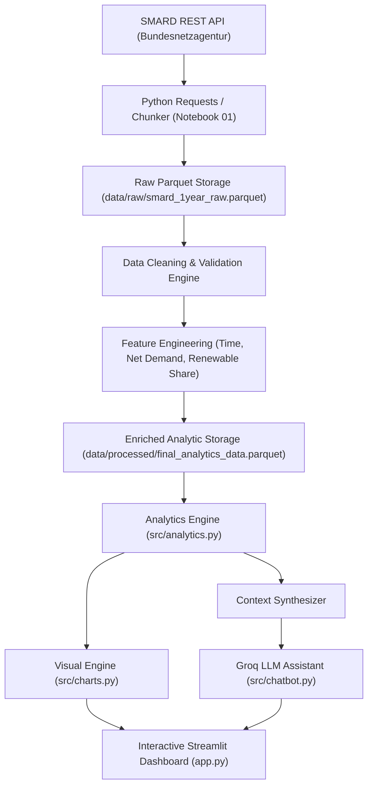

# GridLens DE: German Electricity Market Intelligence & Analytics Platform

[](https://www.python.org/)
[](https://streamlit.io/)
[](https://plotly.com/)
[](https://creativecommons.org/licenses/by/4.0/)
[](https://www.smard.de/)

**GridLens DE** is an end-to-end data analytics and market intelligence platform that evaluates the dynamics of the German wholesale electricity market (*Strommarkt*). Built on verified hourly grid observations from the German Federal Network Agency (**Bundesnetzagentur | SMARD.de**), the platform models generation dispatch, renewable penetration, price volatility, market cannibalization, and net grid load through an interactive **Streamlit** dashboard and a **Groq-powered LLM analytics assistant**.

---

## 1. Executive Summary & Business Problem

Germany's ambitious energy transition (*Energiewende*) has fundamentally transformed European power economics. As weather-dependent intermittent generation (solar PV and wind) expands toward national targets (80% renewable electricity by 2030), power grids encounter complex structural challenges:

1. **The Merit-Order Effect & Negative Pricing:** Renewables operate with near-zero marginal production costs. During hours of simultaneous high wind/solar output and subdued consumer demand, wholesale spot market prices plunge below zero. Under the German Renewable Energy Sources Act (*EEG*), understanding when and why negative pricing occurs is vital for asset operators, traders, and grid managers.
2. **Solar Value Deflation (Cannibalization):** Solar generation is synchronized across the entire country during midday hours. This simultaneous peak production depresses midday wholesale prices, significantly eroding the market capture price of solar assets compared to baseload or dispatchable technologies.
3. **The "Duck Curve" & Net Demand Ramping:** Substantial photovoltaic generation hollows out net demand in the early afternoon, creating a steep ramping requirement in late afternoon/evening hours that must be met by flexible dispatchable capacity (gas and coal).
4. **Grid Stress During Peak Demand:** Despite substantial renewable capacity, peak grid demand hours frequently coincide with low wind and solar availability (*Dunkelflaute*), requiring fossil-fuel generation to surge to balance the grid.

**GridLens DE** bridges raw regulatory grid time-series data and decision-grade business intelligence by providing rigorous statistical modeling, visual analytics, and natural language query capabilities.

---

## 2. Project Objectives

- **Automated Ingestion & ETL:** Collect, validate, and clean 8,619 consecutive hourly observations from the official Bundesnetzagentur SMARD REST API.
- **Empirical Market Economics:** Compute key power market indicators, including renewable penetration share, price capture ratios (market value factors), duck curve profiles, and price-condition segmentation.
- **Interactive Exploration:** Provide energy analysts, traders, and researchers with an interactive Streamlit application featuring dynamic date slicing, custom aggregations, and publication-ready Plotly visualizations.
- **Grounded LLM Querying:** Implement an AI analytics assistant via the Groq API that interprets pre-calculated mathematical context directly from Pandas, ensuring 100% factual fidelity without statistical hallucinations.

---

## 3. Dataset & Regulatory Provenance

### Source & Attribution
The raw operational and market data is published by **SMARD** (*Strommarktdaten*), the official electricity market platform operated by the German Federal Network Agency:
- **Platform:** [SMARD.de – Bundesnetzagentur](https://www.smard.de/)
- **Legal Authority:** Section 111d of the German Energy Industry Act (*Energiewirtschaftsgesetz – EnWG*)
- **Licensing:** [Creative Commons Attribution 4.0 International (CC BY 4.0)](https://creativecommons.org/licenses/by/4.0/)
- **Mandatory Attribution:** *Bundesnetzagentur | SMARD.de*

### Observation Scope & Metrics
The primary analytics dataset encompasses **8,619 consecutive hourly intervals** spanning **August 31, 2025 to August 26, 2026**:

| Metric Name | Column in Parquet | Unit | SMARD Filter ID | Description |
| :--- | :--- | :---: | :---: | :--- |
| **Total Grid Load** | `consumption_mw` | MW | `410` | Realized gross electricity consumption on the German grid |
| **Wind Onshore** | `wind_onshore_mw` | MW | `4067` | Realized hourly onshore wind power generation |
| **Wind Offshore** | `wind_offshore_mw` | MW | `1225` | Realized hourly offshore wind power generation |
| **Photovoltaics** | `solar_mw` | MW | `4068` | Realized solar PV generation feeding into transmission/distribution |
| **Biomass** | `biomass_mw` | MW | `4066` | Dispatchable biomass generation |
| **Hydropower** | `hydro_mw` | MW | `1226` | Run-of-river and reservoir hydro generation |
| **Other Renewables** | `other_renewables_mw`| MW | `1228` | Geothermal and miscellaneous renewable generation |
| **Natural Gas** | `gas_mw` | MW | `4071` | Combined-cycle and open-cycle gas turbine generation |
| **Hard Coal** | `coal_mw` | MW | `4069` | Hard coal generation (*Steinkohle*) |
| **Lignite** | `lignite_mw` | MW | `1223` | Lignite / brown coal generation (*Braunkohle*) |
| **Day-Ahead Spot Price**| `price_eur_mwh` | €/MWh | `4169` | Day-ahead wholesale auction clearing price (DE/LU bidding zone) |

---

## 4. Data Pipeline Architecture



<div align="center">
  
</div>

### ETL & Data Cleaning Methodology
1. **Timestamp Normalization:** Timestamps in millisecond epoch formats are converted to ISO-8601 UTC datetimes and validated for continuous hourly stepping.
2. **Interval & Continuity Validation:** Duplicate timestamps and out-of-order chunks are detected and resolved; zero duplicate records exist in the finalized tables.
3. **Preservation of Market Anomalies:** Negative electricity spot prices (`price_eur_mwh < 0`) are explicitly retained because they represent genuine market settlement dynamics driven by inflexible generation and subsidy mechanisms.
4. **Feature Engineering:**
   - **Listed Generation ($MW$):** $\sum \text{Renewables} + \sum \text{Fossil}$
   - **Renewable Generation Share ($\%$):** $\frac{\text{Renewable } MW}{\text{Listed Generation } MW} \times 100$
   - **Net Demand ($MW$):** $\text{Consumption } MW - \text{Solar } MW$
   - **Peak Demand Classification:** Hours where consumption falls into the top decile ($\ge 90\text{th}$ percentile, $70,597\text{ MW}$ average).
   - **Price Quartile Segmentation:** Categorization into Low Price ($\le 10\text{th}$ percentile), Normal, and High Price ($\ge 90\text{th}$ percentile).
   - **Capture Price Ratio:** $\frac{\sum (\text{Generation}_i \times \text{Price}_i) / \sum \text{Generation}_i}{\text{Average Market Price}}$

---

## 5. Key Empirical Findings

The statistical metrics below are computed directly from the 8,619 verified hourly intervals in the dataset:

### 1. Market Overview & KPIs
- **Average Wholesale Electricity Price:** **€98.74 / MWh**
- **Average Grid Consumption:** **53,853 MW**
- **Peak Grid Consumption:** **78,241 MW**
- **Mean Renewable Generation Share:** **61.11%**
- **Negative-Price Hours:** **514 hours** (~5.96% of the annual sample)

### 2. Generation Fleet Profile (Average Output)
- **Wind Onshore:** **12,981 MW** (dominant renewable contributor)
- **Photovoltaics (Solar):** **9,190 MW**
- **Lignite (Braunkohle):** **7,474 MW** (baseload fossil)
- **Natural Gas:** **7,137 MW** (peaking/cycling capacity)
- **Biomass:** **4,052 MW** (stable dispatchable green power)
- **Hard Coal:** **3,408 MW**
- **Wind Offshore:** **3,408 MW**
- **Hydropower:** **1,507 MW**

### 3. Price Cannibalization & Capture Price Ratios
The market capture ratio measures an asset's revenue per MWh relative to the baseload market price:
- **Hydropower:** **1.031** (€101.84/MWh capture) — dispatchable during high-price hours.
- **Biomass:** **1.028** (€101.55/MWh capture) — dispatchable baseload.
- **Other Renewables:** **1.000** (€98.72/MWh capture).
- **Wind Offshore:** **0.924** (€91.27/MWh capture).
- **Wind Onshore:** **0.856** (€84.47/MWh capture) — affected by wind curtailment and coincident generation.
- **Solar PV:** **0.557** (€54.98/MWh capture) — **severe market cannibalization**: solar produces exclusively during daylight hours when aggregate solar output collapses wholesale spot prices.

### 4. Anatomy of Negative Electricity Prices
During the 514 hours when wholesale prices dropped below €0/MWh (averaging **-€15.79/MWh**):
- **Renewable Share:** Surged to **91.32%** (compared to 59.20% during positive-price hours).
- **Electricity Demand:** Averaged **48,793 MW** (approx. 5,381 MW lower than normal hours, illustrating that negative prices typically occur on weekends or holidays with high wind/sun).
- **Seasonal Concentration:**
  - **Spring:** **233 hours** (45.3% of all negative hours — high wind + rising solar + moderate demand)
  - **Summer:** **164 hours** (31.9% — peak solar + low industrial demand)
  - **Autumn:** **108 hours** (21.0%)
  - **Winter:** **9 hours** (1.8% — high heating and lighting demand protects against price collapse)

### 5. Grid Stress: Peak Demand vs. Normal Demand
Comparing the top 10% peak consumption hours ($\ge 70,597\text{ MW}$) against normal hours:
- Renewable generation rose by only **+4.0%** (from 31,117 MW to 32,356 MW).
- Fossil generation surged by **+80.0%** (from 16,684 MW to 30,031 MW) to cover the capacity shortfall.
- Wholesale electricity prices increased by **+30.4%** (from €95.83/MWh to €124.93/MWh).

### 6. Solar vs. Wind Complementarity
- **Correlation between Solar PV and Onshore Wind:** **-0.295** (negative correlation).
- **Correlation between Solar PV and Offshore Wind:** **-0.300** (negative correlation).
- This empirical anti-correlation validates the strategic benefit of a balanced wind/solar portfolio: wind generation peaks during stormy winter and night periods, complementing midday summer solar peaks.

---

## 6. Dashboard Features & Visualizations

The interactive Streamlit dashboard (`app.py`) provides 12 distinct analytical sections:

1. **Sidebar Controls:** Dynamic date-range picker allowing continuous filtering across any timeframe in the dataset.
2. **KPI Overview Cards:** Real-time metrics for Average Price, Average Demand, Peak Demand, Renewable Share, and Total Negative-Price Hours.
3. **Generation Fleet Mix:** Interactive Plotly pie chart comparing aggregate renewable vs. fossil generation.
4. **Source Breakdown:** Horizontal bar chart ranking generation by individual technology.
5. **Time-Series Analysis:** High-resolution daily average price trend lines and daily renewable penetration share.
6. **Seasonal Comparison:** Grouped bar charts contrasting generation and pricing across Winter, Spring, Summer, and Autumn.
7. **Duck Curve Visualizer:** 24-hour diurnal profile demonstrating how solar generation depresses net grid demand between 10:00 and 16:00.
8. **Price Dispersion & Quartiles:** Grouped generation distribution across Low, Normal, and High electricity price regimes.
9. **Negative-Price Seasonality:** Seasonal breakdown of hours with negative clearing prices.
10. **Peak Demand Stress Analysis:** Generation fleet behavior during top-decile grid load events.
11. **Price Heatmap:** Day-by-hour matrix visualizing spot price variations and negative spikes across the calendar year.
12. **AI Market Intelligence Chatbot:** Conversational assistant grounded in exact calculated statistics.

<div align="center">
  
  <p><em>Figure 1: Grid Overview, Fleet Mix, and Time-Series Analytics.</em></p>
</div>

<div align="center">
  
  <p><em>Figure 2: Diurnal Duck Curve Profiling and Spot Price Heatmap.</em></p>
</div>

---

## 7. AI Market Analytics Chatbot

The application integrates an AI assistant powered by the **Groq API** (`openai/gpt-oss-20b`).

Unlike naive LLM implementations that attempt to calculate statistics internally (leading to math errors), **GridLens DE** employs a strictly grounded approach:
1. The application calculates all metrics, correlations, and quartile tables in **Pandas**.
2. Formatted analytical tables are injected into the LLM system prompt as verified grounding context.
3. The LLM acts solely as an interpretive layer, explaining energy market concepts and citing real numbers directly from the data.

<div align="center">
  
  <p><em>Figure 3: Natural language querying grounded in calculated grid statistics.</em></p>
</div>

---

## 8. Repository Structure

```text
GridLens-DE/
├── .devcontainer/
│   └── devcontainer.json              # VS Code / GitHub Codespaces container setup
├── data/
│   ├── raw/
│   │   └── smard_1year_raw.parquet     # Raw historical time-series from SMARD
│   └── processed/
│       ├── smard_1year_clean.parquet   # Validated and typed dataset
│       ├── smard_1year_enriched.parquet# Time and feature-enriched dataset
│       ├── final_analytics_data.parquet# Production analytics table (8,619 rows, 19 cols)
│       ├── daily_analytics.parquet     # Daily aggregated KPIs
│       ├── seasonal_energy_analysis.parquet
│       ├── seasonal_generation_mix.parquet
│       ├── seasonal_price_analysis.parquet
│       ├── peak_demand_analysis.parquet
│       ├── peak_renewable_analysis.parquet
│       ├── price_quartile_analysis.parquet
│       └── renewable_price_capture.parquet
├── docs/
│   └── GridLens_Architecture.pdf       # Platform architecture and schema document
├── notebooks/
│   ├── .gitkeep
│   ├── 01_SMARD_Data_Pipeline.ipynb    # Data collection and ETL pipeline
│   ├── 02_Energy_Analytics.ipynb       # Statistical modeling and feature engineering
│   ├── 03_Visual_Analytics.ipynb       # Exploratory analysis and chart prototypes
│   └── GridLens DE · Streamlit.pdf     # Architecture and dashboard visual export
├── src/
│   ├── __init__.py                     # Module initializer
│   ├── analytics.py                    # Core statistical and business logic calculations
│   ├── charts.py                       # Reusable Plotly chart builders
│   ├── chatbot.py                      # Groq API client with context injection
│   └── data_loader.py                  # Parquet caching and ingestion handler
├── .env.example                        # Environment variables template
├── .gitignore                          # Git exclusion rules for secrets and virtualenvs
├── app.py                              # Streamlit application entry point
├── requirements.txt                    # Production Python dependencies
└── README.md                           # Project documentation
```

---

## 9. Technology Stack

- **Core Language:** Python 3.11+
- **Data Manipulation & Analytics:** Pandas, NumPy, PyArrow
- **Interactive Visualization:** Plotly Express, Plotly Graph Objects
- **Web Application Framework:** Streamlit
- **LLM & Inference API:** Groq Cloud API (`openai/gpt-oss-20b`)
- **Data Format:** Apache Parquet (columnar storage with Snappy compression)
- **Containerization / Development:** Dev Containers / GitHub Codespaces

---

## 10. Local Installation & Execution

### Prerequisites
- Python 3.11 or higher
- Git
- A free [Groq Cloud API Key](https://console.groq.com/keys) (optional, required only for the AI Chatbot)

### Step 1: Clone the Repository
```bash
git clone https://github.com/saichandra9999-alml/GridLens-DE.git
cd GridLens-DE
```

### Step 2: Create and Activate a Virtual Environment
- **Windows (PowerShell):**
  ```powershell
  python -m venv .venv
  .venv\Scripts\Activate.ps1
  ```
- **Linux / macOS (Bash):**
  ```bash
  python3 -m venv .venv
  source .venv/bin/activate
  ```

### Step 3: Install Dependencies
```bash
pip install -r requirements.txt
```

### Step 4: Configure Environment Variables
Copy the `.env.example` template to `.env`:
```bash
cp .env.example .env
```
Open `.env` and set your Groq API key:
```env
GROQ_API_KEY=your_actual_groq_api_key_here
```
*(Alternatively, set the environment variable directly in your terminal: `export GROQ_API_KEY="your_key"` or `$env:GROQ_API_KEY="your_key"` in PowerShell).*

### Step 5: Launch the Streamlit Application
```bash
streamlit run app.py
```
The application will open automatically at `http://localhost:8501`.

---

## 11. Live Deployment

The application is deployed on **Streamlit Community Cloud**:
- **Live URL:** [https://gridlens-de-cpx2jpx3ba6cuo3safmdyz.streamlit.app/](https://gridlens-de-cpx2jpx3ba6cuo3safmdyz.streamlit.app/)

To deploy your own instance:
1. Push this repository to your GitHub account.
2. Sign in to [share.streamlit.io](https://share.streamlit.io/).
3. Connect your repository, select `app.py` as the entry point.
4. Add `GROQ_API_KEY` to the **Secrets** section in the Streamlit Cloud dashboard.
5. Deploy.

---

## 12. Project Limitations & Analytical Boundaries

1. **Temporal Scope:** The current dataset covers a single operational year (8,619 hours from August 2025 to August 2026). While statistically representative of modern renewable penetration, multi-year analyses are required to model long-term climate cycles (*Dunkelflaute* variance).
2. **Wholesale Spot Market Focus:** Prices reflect the Day-Ahead auction clearing price for the unified Germany/Luxembourg bidding zone. Intraday continuous auctions, balancing energy market settlements, grid fees, renewable surcharges, and cross-border redispatch costs are not captured.
3. **Transmission Grid Topology:** Generation and demand are modeled as a copper-plate bidding zone; local transmission bottlenecks between windy northern Germany and industrial southern Germany are abstracted.
4. **LLM Context Boundaries:** The chatbot synthesizes answers exclusively from the pre-calculated statistics generated by `src/analytics.py` for the user's selected date window. It does not perform ad-hoc SQL queries or external web searches.

---

## 13. Attribution, Credits & Authorship

- **Original Project & Architecture:** Developed by **Krishna Vamshi Pokala** ([@Krishnavamshi07](https://github.com/Krishnavamshi07)) and team.
- **Repository Maintainer & Analyst:** **Sai Chandra** ([@saichandra9999-alml](https://github.com/saichandra9999-alml)) — Independent portfolio publication, code validation, security hardening, documentation enhancement, and testing.
- **Data Source:** **Bundesnetzagentur | SMARD.de** under Creative Commons Attribution 4.0 International ([CC BY 4.0](https://creativecommons.org/licenses/by/4.0/)).
